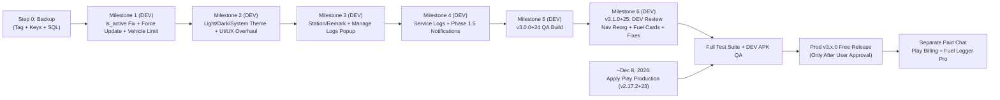

# Fuel Logger — Master Product & Engineering Plannings

> **Status:** Milestones 1–6 Built on `feat/v3-dev` (DEV APK `3.1.0+25` Verified • Pending DEV SQL Migrations & Real-Device QA)  
> **Active Repository:** `C:\Users\arunb\PycharmProjects\FuelLogger-Flutter` (`https://github.com/Arunb001/FuelLogger-Flutter.git`)  
> **Current Production Baseline:** `Version - 2.17.2 (Build 23)` (`main` commit `4f3eedd`)  
> **Play Store Closed Testing Window:** Started `2026-11-24` (21 opted-in testers) • Target Production Apply Date: `~2026-12-08`  
> **Historical Changelog:** [`instructions.md`](instructions.md)

---

## 1. Mandatory Developer Rules & Antigravity Skills (For Development Chats)

> **CRITICAL:** Every development chat working on `FuelLogger-Flutter` MUST follow these rules without exception.

### 1.1 Development & Build Workflow Rules
1. **Take Last Production Backup Before Any DEV Changes / Development Starts (Mandatory First Gate):**
   - Before making **any** DEV code changes or starting feature development, complete the full last-production backup in Section 2.2 first:
     - Freeze & push Git tag `v2.17.2-build23` + branch `backup/v2.17.2-pre-v3` at current production commit `4f3eedd`.
     - Archive all gitignored last-production outputs & signing secrets locally (`build/app/outputs/bundle/prodRelease/app-prod-release.aab`, `build/app/outputs/flutter-apk/app-prod-release.apk`, `build/app/outputs/mapping/prodRelease/mapping.txt`, `symbols/`, `android/upload-keystore.jks`, `android/key.properties`) — **never commit signing keys to GitHub**.
     - Export current **PROD** (`hjprefmnofrqyjocihto.supabase.co`) and **DEV** (`qjwuajdcyrdlnjplvtsr.supabase.co`) Supabase schemas & data snapshots.
   - Only **after** the last production backup is verified complete may development begin on an isolated feature branch (e.g., `feat/v3-dev`).
2. **DEV-Only Builds Until Explicit Approval:**
   - Always build and test **DEV flavor only**:
     ```bash
     flutter build apk --flavor dev -t lib/main_dev.dart --release
     ```
   - DEV connects strictly to DEV Supabase (`https://qjwuajdcyrdlnjplvtsr.supabase.co`, package `com.fuellogger.app.dev`, name `"Fuel Logger (DEV)"`).
   - **NEVER** build PROD (`--flavor prod`, `com.fuellogger.app`, `https://hjprefmnofrqyjocihto.supabase.co`) or compile `.aab` bundles unless explicitly told *"proceed with production"*.
3. **Always Maintain SemVer + Build Number:**
   - Every code iteration, bugfix, or feature build **MUST** increment and synchronize [`lib/config/version.dart`](lib/config/version.dart) (`appVersion`, `buildNumber`) and [`pubspec.yaml`](pubspec.yaml) (`version: X.Y.Z+N`) before building or pushing.
4. **Test Everything First $\rightarrow$ Synchronous Foreground Build $\rightarrow$ GitHub Push:**
   - **Step A (Verify First):** Run `dart analyze lib`, unit tests (`flutter test`), and check all affected flows (Light/Dark/System themes, offline cache, Supabase sync) **before** starting an APK build.
   - **Step B (Foreground Build Monitoring):** Never leave an APK/AAB build running unmonitored in the background. Wait and check build progress until compilation completes and confirm success before finishing your turn.
   - **Step C (Docs & GitHub Push):** Update [`instructions.md`](instructions.md) (changelog & release summary) and check off completed items in this `Plannings.md`, then commit with a clear message and push to `origin` on GitHub.
   - **Step D (Notify User):** Report test results, exact build output path/size, and commit hash only after everything succeeds.
5. **Backward-Compatible SQL Migrations:**
   - Save every SQL change as an idempotent migration script under `supabase_migrations/` (using `IF NOT EXISTS` / `ADD COLUMN IF NOT EXISTS`) and verify on DEV Supabase before ever touching PROD.

### 1.2 Installed & Recommended Antigravity Skills / Plugins
- **Dart and Flutter** (`antigravity-plugins-official/plugin/flutter` — *Installed*):
  - Use skills `flutter-apply-architecture-best-practices`, `flutter-build-responsive-layout`, `flutter-fix-layout-issues`, `dart-run-static-analysis`, `dart-add-unit-test`, `flutter-add-widget-test`, plus `flutter_dart-mcp-server` tools.
- **Mobbin** (`antigravity-plugins-partners/plugin/mobbin` — *Installed*):
  - Read `best-practices` first, then use `search` + `redesign-screen` + `plain-writing` when redesigning Fuel Logger screens so the UI feels human-crafted rather than AI-templated.
- **Built-in Skills**:
  - `permissioned-github` (safe GitHub operations), `run-workflow`, `research`.
- **Optional Future Plugin**:
  - `antigravity-plugins-partners/plugin/supabase` (if direct Supabase MCP / Postgres best-practice checks are desired later).

---

## 2. Step 0: Pre-Development Backup & Environment Baseline

### 2.1 Dual-Environment Map
| Environment | Package ID | App Name | Supabase URL | Current Role |
| :--- | :--- | :--- | :--- | :--- |
| **DEV** | `com.fuellogger.app.dev` | `Fuel Logger (DEV)` | `https://qjwuajdcyrdlnjplvtsr.supabase.co` | **Active target for all v3 development & testing** |
| **PROD** | `com.fuellogger.app` | `Fuel Logger` | `https://hjprefmnofrqyjocihto.supabase.co` | Frozen at `v2.17.2+23` Closed Testing until Dec 8+ |

### 2.2 Step 0: Last Production Backup Checklist (Execute Before Any DEV Changes Start) `[APPROVED]`
Because [`.gitignore`](.gitignore) excludes `*.jks`, `*.keystore`, `key.properties`, `symbols/`, and `build/`, git alone does **not** back up signing secrets or compiled Play Store bundles:
- [ ] **1. Git Tag & Freeze Branch:** Create annotated tag `v2.17.2-build23` and branch `backup/v2.17.2-pre-v3` at production commit `4f3eedd`, and push both to `origin`.
- [ ] **2. Offline Archive of Last Production Release & Secrets:** Copy `android/upload-keystore.jks`, `android/key.properties`, `symbols/`, `build/app/outputs/bundle/prodRelease/app-prod-release.aab`, `build/app/outputs/flutter-apk/app-prod-release.apk`, and `build/app/outputs/mapping/prodRelease/mapping.txt` into a secure local/cloud backup folder (never commit keystores to GitHub!).
- [ ] **3. Supabase Schema & Data Export:** Export PROD (`hjprefmnofrqyjocihto.supabase.co`) and DEV (`qjwuajdcyrdlnjplvtsr.supabase.co`) table schemas and data snapshots from Supabase Dashboard before executing new SQL migrations.
- [ ] **4. Feature Branch Isolation:** Create `feat/v3-dev` from `backup/v2.17.2-pre-v3` only after Steps 1–3 succeed, keeping `main` untouched at `v2.17.2+23` during DEV development.

---

## 3. Priority Bug Fix

### BUG-01: `vehicles.is_active` Column Always `FALSE` on Newly Created Vehicles `[APPROVED]`
- **Observed Symptom:** In Supabase `public.vehicles`, `is_active` is `TRUE` only for the signup-created `'My Vehicle'` (and stays `TRUE` if renamed). Any newly created vehicle inserts `is_active = FALSE` and never flips to `TRUE` when active/switched.
- **Verified Root Cause:**
  1. `handle_new_user()` SQL trigger inserts `'My Vehicle'` with `is_active = true`.
  2. [`SupabaseService.addVehicle`](lib/services/supabase_service.dart#L168-L172) hardcodes `'is_active': false`.
  3. [`GarageProvider.switchVehicle`](lib/providers/garage_provider.dart#L130-L149) only saves the active vehicle name locally via `CacheService.setActiveVehicle(v.name)` and never updates Supabase.
  4. [`GarageProvider.loadGarage`](lib/providers/garage_provider.dart#L104-L108) ignores `v.isActive` from DB, and [`deleteVehicle`](lib/providers/garage_provider.dart#L249-L263) does not promote the remaining vehicle in Supabase.
- **Solution Design:**
  1. **SQL Migration (`set_active_vehicle` RPC + Partial Unique Index):**
     - Add `CREATE UNIQUE INDEX IF NOT EXISTS idx_one_active_vehicle_per_user ON public.vehicles(user_id) WHERE is_active = true;`.
     - Create `public.set_active_vehicle(p_vehicle_id UUID)` (`SECURITY INVOKER` or `auth.uid()` check) that atomically sets `is_active = (id = p_vehicle_id)` for all vehicles belonging to `auth.uid()`.
  2. **Dart Client Sync:**
     - Add `SupabaseService.setActiveVehicle(String vehicleId)` calling the RPC (with graceful offline handling).
     - Call it inside `GarageProvider.switchVehicle()`, after `addVehicle()` (since `addVehicle` switches to the newly created vehicle), and inside `deleteVehicle()` when promoting the fallback active vehicle.
     - In `loadGarage()`, resolve active vehicle priority: local cache match $\rightarrow$ DB row where `isActive == true` $\rightarrow$ `vehicles.first` (and sync DB if needed).
- **Pros & Cons:**
  - *Atomic RPC + Partial Index (Chosen):* **Pros:** Zero race conditions; impossible to have 2 active rows or 0 active rows; single HTTP call; syncs across devices. **Cons:** Requires deploying 1 SQL migration to DEV (and later PROD).
  - *Client-side two-step PATCH:* **Pros:** No SQL migration. **Cons:** Network drop between setting `false` and `true` leaves 0 active vehicles.

---

## 4. Approved Free-Core Feature Specifications

> **Core Product Policy:** **Zero Ads forever.** Keep core logging, unlimited historical logs, themes, service logs, and notifications clean and delightful without ad clutter.

### F1: Human-Crafted UI/UX Overhaul (Eliminate "Made by AI" Feel) `[APPROVED]`
- **Diagnosis from Current Repo Screenshots (`store_assets/screenshots/01..05.png`):**
  - Repetitive identical bordered cards (`#1E222D` + `0.8px #2D3342` border everywhere) and uniform rounded-square icon boxes.
  - Home dashboard uses 3 vertical launcher cards leaving ~40% dead space below, lacks bottom navigation, charts, recent-fill summary, or service alerts.
  - Unformatted numbers (`3520 km`, `₹15281`), mixed center/left field alignments on Upload, emoji strings (`➕`), and developer-style labels (`S.No / Run # *`, `Upload Fuel Log`).
- **Implementation Plan (Use Mobbin `redesign-screen` + Flutter responsive skills):**
  1. **Persistent App Shell (`MainShell`):** Clean Bottom Navigation Bar (`Home`, `Insights`, `+ Log`, `Logs`, `Utilities`) + prominent `+ Log` button/FAB so users navigate in 1 tap instead of bouncing through home launcher cards. Service is accessed via **Fuel/Service toggles** on the Log, Insights, and Logs pages — not a separate bottom nav tab.
  2. **Humanized Home Dashboard:**
     - Top bar with subtle branding, **Notification Bell (with unread badge)**, and **Settings** icon.
     - Refined Vehicle Hero Banner (tonal gradient, odometer badge, tap to switch).
     - Conditional **Service Due Alert Card** (shown when due soon / overdue).
     - **Hero KPIs + Mini Mileage Trend Chart + Latest Fill-Up Snapshot** card.
  3. **Visual Polish & Copy:**
     - Replace heavy 1px card borders everywhere with clean tonal surface elevation & generous whitespace.
     - Use `intl` `NumberFormat` (`3,520 km`, `₹15,281`) and `FontFeature.tabularFigures()` for crisp numeric alignment.
     - Replace technical wording (`"Upload Fuel Log"` $\rightarrow$ `"Save Fill-Up"`, `"S.No / Run # *"` $\rightarrow$ compact auto-numbered `"Entry #14"` chip with optional edit).
     - Add subtle `HapticFeedback.lightImpact()` on mode toggles/save and clean `fl_chart` (or custom painter) graphs on Insights/Calculations.
- **Pros & Cons:**
  - *Full Shell + Dashboard Redesign (Chosen):* **Pros:** Genuine Play Store-grade feel; fits new `Service Logs` & `Notifications` naturally; differentiates from ad-heavy competitors. **Cons:** Touches all main screens; requires careful Light/Dark QA.
  - *Minor CSS/Color Tweaks Only:* **Pros:** Faster. **Cons:** Still feels like an AI-generated launcher list.

---

### F2: Light, Dark, and System Theme Support `[APPROVED]`
- **Current Gap:** [`app_theme.dart`](lib/theme/app_theme.dart) defines only `darkTheme`, while views hardcode `Colors.white`, `Colors.white70`, `AppTheme.cardBg`, and `ThemeData.dark()` inside `showDatePicker`.
- **Implementation Plan:**
  - Add `ThemeProvider` (`ThemeMode.system` default; user selectable **System / Light / Dark** in Settings, persisted in `CacheService`).
  - Build `AppTheme.lightTheme` (`#F6F7FB` canvas, `#FFFFFF` cards, `#E2E6EF` subtle dividers, `#12151C` ink text, darkened accessible emerald/blue/amber/red metrics for WCAG contrast on white) + refined `AppTheme.darkTheme`.
  - Introduce `ThemeExtension<AppSemanticColors>` (`context.appColors`) and replace every hardcoded color across all views, dialogs, snackbars, and date pickers.
- **Pros & Cons:**
  - *`ThemeExtension` Semantic Tokens (Chosen):* **Pros:** Zero white-on-white contrast bugs; clean Light & AMOLED Dark parity; future-proof. **Cons:** Requires auditing every widget and dialog.
  - *Inline `isDark` ternaries:* **Pros:** Quick locally. **Cons:** High bug risk in modals/pickers.

---

### F3: Fuel Station Name & Remark Fields on Upload & Edit `[APPROVED]`
- **Schema & Model Changes:**
  - `ALTER TABLE public.fuel_logs ADD COLUMN IF NOT EXISTS station_name TEXT;`
  - `ALTER TABLE public.fuel_logs ADD COLUMN IF NOT EXISTS remark TEXT;`
  - Update [`FuelLog`](lib/models/fuel_log.dart), [`CsvService`](lib/services/csv_service.dart) (export + optional header import), `UploadView`, and `LogsView`.
- **UX Flow:**
  - **Upload Form & Edit Dialog:** Add optional **`Fuel Station`** field with 1-tap recent-station suggestion chips (populated from user's prior stations + common defaults like `IndianOil`, `HPCL`, `BPCL`, `Shell`, `Jio-bp`) and optional **`Remark`** field (e.g., `"Highway trip"`, `"City traffic"`).
- **Pros & Cons:**
  - *Nullable `TEXT` + Smart Suggestion Chips (Chosen):* **Pros:** Fast zero-friction entry; no GPS location permission needed (preserves strict privacy promise); works offline; unlocks future station-comparison insights. **Cons:** Minor spelling variations (`"HP"` vs `"HPCL"`) unless user taps chips.
  - *Normalized `stations` Table + GPS:* **Pros:** Canonical names. **Cons:** Requires location permissions, Privacy Policy changes, and extra joins.

---

### F4: Manage Logs — Mileage & Fuel Station on Cards + Tap-to-Open Detail Popup (Option A Locked) `[APPROVED]`
- **Context:** Supersedes `v2.17.0` (`9cec6df`) partial removal while keeping cycle secrets protected.
- **Approved UX (Option A):**
  - **Card List (`LogsView`):**
    - Shows: **Run #**, **Date**, **Full / Partial Badge**, **Fuel Cost**, **Volume (L)**, **Odometer**, **Fuel Type**, **Fuel Station Name** (chip if entered), and **Calculated Mileage (`km/l`)** (or `"In Tank"` / `"Partial"` when open).
    - Keeps `fuel_consumed` (`8.43 L used`), `distance_traveled`, and `cost_per_km` **hidden** from the Manage Logs cards and popup so per-run refill pairing stays obscured.
    - Removes cramped inline Delete icon from the card list to avoid accidental taps.
  - **Tap Any Card $\rightarrow$ Log Detail Pop-Up:**
    - Clean modal showing **all user-entered fields** (Run #, Date, Fill Mode, Fuel Type, Station Name, Fuel Cost, Volume, Odometer, Density, Remark) + **Mileage** (`calculatedMileage`) + **Edit** button (and **Delete** with confirmation inside Edit/Detail popup).
- **Pros & Cons:**
  - *Option A (Card shows Mileage + Station; Popup shows all inputs + Mileage + Edit):* **Pros:** Clean scannable cards; gives users requested mileage & station visibility + full remark inspection; keeps `fuel_consumed` hidden. **Cons:** 1 extra tap to edit compared to inline pencil button; exposes per-run mileage (`calculatedMileage`) on logs again (binary protected by Flutter AOT + `--obfuscate`).

---

### F5: New "Service Logs" — Merged via Fuel/Service Toggle (No Separate Tab) `[APPROVED — Updated 2026-11-27]`
- **Change from Original Design:** Service Logs are **no longer a separate bottom nav tab**. Instead, the Log Fill-Up page, Insights page, and Logs page each have a **Fuel / Service toggle** at the top.
  - `Log Fill-Up Page`: Toggle between Fuel form and Service form
  - `Insights Page`: Toggle between Fuel insights and Service insights
  - `Logs Page`: Toggle between Fuel log history and Service log history
- **Database & Cache (`public.service_logs`):** *(Unchanged)*
  - Columns: `id UUID PK`, `user_id UUID FK`, `vehicle_id UUID FK ON DELETE CASCADE`, `service_date DATE NOT NULL`, `odometer NUMERIC(10,1) NOT NULL`, `service_type TEXT NOT NULL`, `service_center TEXT`, `total_cost NUMERIC(10,2) NOT NULL`, `next_due_km NUMERIC(10,1)`, `next_due_date DATE`, `notes TEXT`, `created_at TIMESTAMPTZ`, `updated_at TIMESTAMPTZ`.
  - RLS policy: `auth.uid() = user_id` + index `(vehicle_id, service_date DESC)`.
  - Offline local caching in `CacheService` (`cached_service_logs_<vehicleId>`).
- **Page Features:**
  - **KPI Summary Header:**
    1. **Total Service Cost** (all-time for active vehicle)
    2. **Recent Service Cost** (latest entry)
    3. **Next Service Due (KMs)** — computes remaining `next_due_km - latestOdometer` (with due-soon amber / overdue red state!)
    4. **Next Service Due (Date)** — computes days left until `next_due_date`
  - **CRUD:** Add Service Log modal/screen, chronological service history cards, tap to view/edit/delete service logs.
- **Pros & Cons:**
  - *Separate `service_logs` Table (Chosen):* **Pros:** Keeps fuel cycle calculations 100% isolated and clean; scales easily to EV & ICE maintenance. **Cons:** New table, RLS, model, and cache key required.
  - *Unified `logs` table:* **Pros:** One table. **Cons:** Pollutes odometer fuel cycle math and CSV exports.

---

### F6: Notifications Page, Phase 1.5 DB-Scheduled Push, Reminders, Wishes & Home Banner `[APPROVED]`
- **UI & Triggers:**
  - **Notifications Page (`NotificationsView`):** Opened via Bell Icon (unread badge) on Home. Displays Welcome message for new users, recent notification history (read/unread, clear/mark-read), and action tap (e.g., opens Service Logs or Upload).
  - **Home Screen Integration:** Dedicated **Service Due Banner** appears on Home whenever `next_due_km - latestOdometer <= 500 km` or `next_due_date - today <= 7 days` (or overdue).
  - **Automatic Engagement Categories:**
    1. *Welcome & Onboarding* (first sign-in)
    2. *Service Due Reminders* (km & date thresholds)
    3. *Gentle Fill-Up Check-in* (local scheduled nudge e.g. 14 days after last fill; rescheduled automatically on every new log)
    4. *Milestones & Seasonal/Festival Wishes* (e.g., 1,000 / 5,000 / 10,000 km tracked, best mileage record, and DB-scheduled festival/update wishes)
  - **Settings Toggle:** Allow user to mute/customize reminder frequency; update [`PRIVACY_POLICY.md`](PRIVACY_POLICY.md) to disclose local notification permission (`POST_NOTIFICATIONS`).

- **Phase 1.5 Technical Architecture (Supabase DB + Local Exact Alarms + Daily Background Sync):**
  - **Tables:**
    - `public.app_announcements` (`id`, `title`, `body`, `category`, `scheduled_at TIMESTAMPTZ`, `expires_at TIMESTAMPTZ`, `target_route`, `is_active`) — read-only RLS for authenticated users.
    - `public.user_notifications` (optional/sync read state per user) + local `CacheService` `seen_announcement_ids` deduplication.
  - **Delivery Packages:** `flutter_local_notifications` + `timezone` (converts Supabase UTC `scheduled_at` to device local timezone e.g. **IST**) + `workmanager` (lightweight periodic ~12–24h background fetch).
  - **How "On Time" Delivery Works:**
    1. On app open AND during periodic `workmanager` background sync, app fetches `app_announcements` where `is_active = true` and `expires_at > now()`.
    2. Future items (`scheduled_at > now`) are scheduled as exact OS local alarms (`zonedSchedule`) so they ring at the exact minute (e.g., 9:00 AM IST on Diwali/New Year) even if offline at that time.
    3. Already-due items (`scheduled_at <= now` and unseen) appear in the Notification Center and trigger once.

- **How You Push Notification Data Into the Database (Operations Guide):**
  1. **Method 1 — Supabase Dashboard GUI (Fastest, No Code):** Go to Supabase Dashboard $\rightarrow$ **Table Editor** $\rightarrow$ `app_announcements` $\rightarrow$ **Insert Row** $\rightarrow$ fill `title`, `body`, `category` (`wish`/`tip`/`update`), `scheduled_at` (e.g. `2026-12-31 18:30:00+00` for Jan 1 00:00 IST, or enter with `+05:30`), `expires_at`, `is_active = true` $\rightarrow$ Save.
  2. **Method 2 — SQL Editor (Batch Festival/Campaign Calendar):** Run one SQL `INSERT` script scheduling multiple festival/app-update announcements for the month ahead.
  3. **Method 3 — Optional Future Admin Helper:** Lightweight protected script/panel if you later want a form outside Supabase Dashboard.
  - *Important:* Always test announcement rows on **DEV Supabase** first before inserting into **PROD Supabase**.

- **Pros & Cons:**
  - *Phase 1.5 (DB + Local Alarms + `workmanager`):* **Pros:** ₹0 hosting cost; no Firebase setup or Google Services JSON needed; offline-capable alarms; fetches new wishes even when app isn't opened every day. **Cons:** OEM aggressive battery savers (Xiaomi/Realme/Samsung) may delay `workmanager` slightly; instantaneous minute-by-minute server push without prior sync requires Phase 2 (`FCM` + Edge Functions) later.

---

### F7: Unlimited Vehicle Add (Free) `[APPROVED — Updated 2026-11-27]`
- **Previous Rule:** 2-Vehicle Free Limit with grandfathering. **SUPERSEDED** by user instruction on 2026-11-27.
- **New Rule:** Vehicle add is **completely free and unlimited** for all users. No limit dialog, no grandfathering logic, no `user_entitlements` table needed.
- **Implementation:**
  1. [x] Removed `canAddVehicle` limit check in `GarageProvider` (`canAddVehicle => true`).
  2. [x] Removed `VehicleLimitDialog` widget and imports.
  3. [x] Removed quota label (`1/2 free`) from Settings "Add New Vehicle" card.
  4. [x] Removed `VehicleLimitDialog` guard from `VehicleBanner._showAddVehicleDialog`.
  5. [x] Removed unused `lib/widgets/vehicle_limit_dialog.dart`, `lib/models/user_entitlement.dart`, and `user_entitlements` client queries (history preserved on git).
- **Paid Future Note:** If Pro adds vehicle limits later, it will be on a separate `feat/pro-billing` branch; the Free tier stays unlimited for now.

---

### F8: Critical & 2-Backward-Version App Update Enforcement `[APPROVED]`
- **Goal:** Ensure users stay within the latest **3 supported releases** (`Current N`, `N-1`, `N-2`) and immediately prompt/require updates when a **critical update** is released or a user falls **> 2 versions behind** (`<= N-3`).
- **Implementation Plan:**
  1. **Supabase Version Control Table (`public.app_config` — Separate in DEV & PROD):**
     - Row (`platform = 'android'`):
       - `latest_version TEXT` (e.g. `'3.2.0'`)
       - `latest_build INT` (e.g. `28`)
       - `min_supported_build INT` (normally set to build of `N-2`; raised immediately to `latest_build` if a release is critical!)
       - `is_critical BOOLEAN`
       - `update_title TEXT`, `update_notes TEXT`
       - `play_store_url TEXT` (`https://play.google.com/store/apps/details?id=com.fuellogger.app`)
  2. **2-Backward-Version Rule & Client Check (`UpdateCheckerService`):**
     - Runs non-blockingly on Home launch (with short timeout).
     - Compare `AppVersion.buildNumber` vs `app_config`:
       - **Case 1 (`buildNumber < min_supported_build` — Critical OR > 2 versions behind):** Show **non-dismissible modal dialog** (blocks back button via `PopScope(canPop: false)`) with **"Update Now"** button opening Google Play (`market://details?id=...` + HTTPS fallback).
       - **Case 2 (`min_supported_build <= buildNumber < latest_build` — 1 to 2 versions behind):** Show **dismissible update banner / optional dialog** (*"Update Available"* with `"Update"` and `"Later"`).
       - **Case 3 (`buildNumber >= latest_build`):** Up to date — silent!
  3. **Google Play In-App Updates (`in_app_update` package — Optional Companion):**
     - Supports native Play Store Immediate (critical) and Flexible (soft) update flows on PROD builds installed via Google Play.
  4. **Offline & DEV Safety Guardrails:**
     - **Offline Protection:** If user has no internet (at a petrol pump), never block the app unless a previously cached verified `min_supported_build` already flagged this build as unsupported (and even then, optionally allow offline viewing/emergency logging or keep safe timeout!).
     - **DEV Protection:** Skip or show a mockable debug toggle on `AppConfig.isDev` so DEV testing is never locked out accidentally.
- **Pros & Cons:**
  - *Supabase `app_config` + Play Store Deep Link (+ optional `in_app_update`) (Chosen):* **Pros:** You control exact `min_supported_build` & critical flags instantly in Supabase (works for both Play Store and sideloaded DEV APKs!); supports exact 2-backward-version rule; zero cost. **Cons:** Requires disciplined update of `app_config` row whenever releasing a new Play Store build.

---

### F9: Fuel Cards & Utilities Page (NEW) `[APPROVED — 2026-11-27]`
- **New Bottom Nav Item:** `Utilities` replaces `Service` in position 5. Currently contains one feature: **Fuel Cards**.
- **Purpose:** Users track monthly spending limits on physical fuel cards (HPCL, BPCL, etc.), with automatic monthly resets.
- **Database (`public.fuel_cards`):**
  - Columns: `id UUID PK`, `user_id UUID FK`, `card_name TEXT NOT NULL`, `card_limit NUMERIC(12,2)`, `limit_used NUMERIC(12,2)`, `is_primary BOOLEAN DEFAULT false`, `reset_day_of_month INT (1–31)`, `last_reset_at TIMESTAMPTZ`, `created_at TIMESTAMPTZ`, `updated_at TIMESTAMPTZ`.
  - Partial unique index: `idx_one_primary_card_per_user ON fuel_cards(user_id) WHERE is_primary = true` — only one primary card per user.
  - RLS: `auth.uid() = user_id`.
  - FK link: `fuel_logs.fuel_card_id UUID REFERENCES fuel_cards(id) ON DELETE SET NULL` — tracks which card was used per fill-up.
- **Primary Card Selection:** User sets one card as primary in Utilities. Home page "Fuel Card Limit" box shows primary card's remaining balance.
- **Auto-Reset Logic:**
  - Each card stores `reset_day_of_month` (1–31). Days 29/30/31 auto-fallback to last day of shorter months.
  - Track `last_reset_at` timestamp — on app open/refresh, check if `last_reset_at` month is before the current month's reset date → reset `limit_used` to 0.
  - Client-side check (no pg_cron needed).
- **Fuel Fill-Up Integration:**
  - Optional fuel card dropdown on Log Fill-Up page (next to date field).
  - When selected, `limit_used += fuel_cost` on save.
  - If editing/deleting a fill-up linked to a card, adjust `limit_used` accordingly.
- **CRUD:** Add (modal with card name, limit, reset day), Edit (tap card), Delete (swipe/long-press + confirm).
- **Pros & Cons:**
  - *Client-Side Reset + FK Link (Chosen):* **Pros:** Zero server cost; works offline; immediate feedback on remaining limit; simple to implement. **Cons:** If user doesn't open app for months, multiple resets happen on first open (but that's correct behavior — limit should reset each missed month).

---

## 5. Held Feature (`[ON_HOLD]`): EV Mileage & Efficiency Calculations

> **Status:** `[ON_HOLD]` — **Do NOT implement in current DEV sprint.** Clarify calculation method with user first.

### Options Ready for Future Decision
1. **Method 1 — Full-Charge-to-Full-Charge (`100% → 100%`) Cycle** *(Matches existing Petrol forward-linking engine)*:
   - Log `Energy Added (kWh)`, `Charging Cost (₹)`, `Odometer (km)`, `Charger Type` (`Home AC` / `DC Fast`), and `Full Charge (100%)` `'F'` vs `Partial Top-Up` `'P'`.
   - Closed cycle outputs: **`km/kWh`**, **`Wh/km`**, **`₹/km`**, **`₹/kWh`**.
   - *Pros:* 100% accurate billed energy (includes real AC$\rightarrow$DC charger losses). *Cons:* Needs occasional 100% charges to close a cycle.
2. **Method 2 — Battery Capacity + Start/End SOC `%` Delta Estimation**:
   - Store vehicle `battery_capacity_kwh` once; log `start_soc %` $\rightarrow$ `end_soc %` for `20% → 80%` partial charges.
   - *Pros:* Estimates efficiency on every partial charge. *Cons:* Approximate due to charging losses (10–15%), BMS reserve, and battery degradation.

---

## 6. Future Paid Application Strategy (`Fuel Logger Pro`) & Separate Chat Workflow

### 6.1 Architectural Strategy: ONE App + Play Billing IAP (`feat/pro-billing`) + Separate Chat
- **Why ONE Play Store App (`com.fuellogger.app`) instead of a separate paid APK (`com.fuellogger.app.pro`):**
  1. Preserves all Closed Testing work (12 testers $\times$ 14 days does NOT have to be repeated for a new listing!).
  2. Keeps 100% of users, reviews, ratings, and Play Store SEO in one place.
  3. Users upgrade in 1 tap without losing logs or reinstalling.
- **How Separate Chat Maintenance Works Cleanly:**
  1. **Shared Contract:** Both the **Free Core Chat** and the future **Paid/Pro Chat** read this `Plannings.md`.
  2. **Branch Isolation:** Free updates build on `feat/v3-dev` $\rightarrow$ `main`; Paid/Pro work runs in a **separate Paid Chat** on branch **`feat/pro-billing`** (using `in_app_purchase`, `user_entitlements` table in Supabase, and Play Console Billing).
  3. **Pricing Direction:** One-time Lifetime **Fuel Logger Pro** unlock (e.g., ₹199–₹349 / \$3.99–\$4.99) and/or optional low annual plan for cloud-storage features — **ZERO ads**.

### 6.2 Free vs. Paid Feature Separation Matrix
| Feature Area | **FREE** *(Build Now in DEV)* | **FUTURE PAID — `Fuel Logger Pro`** *(Separate Paid Chat Later)* |
| :--- | :--- | :--- |
| **Vehicles** | **Unlimited Vehicles** (Free for all users) | Family/Fleet Shared Garage |
| **Fuel & EV Logging** | Unlimited logs, Station & Remarks, Manage Logs Popup, CSV Import/Export | **Receipt / Bill Photo Attachments + OCR Auto-Fill** *(covers Storage/AI costs)* |
| **Themes & UI** | Human-crafted UI/UX + Light / Dark / System Mode | Extra accent packs / home widgets *(nice-to-have)* |
| **Service Logs** | Service Logs page + Next due km/date + Home Service Due Banner | **Multi-Part Maintenance Rules + Insurance/PUC/RC Document Vault** |
| **Notifications** | Welcome, Service Due alerts, basic nudges, DB-scheduled wishes | Advanced custom multi-interval service alerts |
| **Analytics & Reports** | Core KPIs, per-fuel breakdown, basic trend chart | **Branded PDF Tax / Expense Reports**, Station efficiency/price rankings, Fuel vs. EV savings analyzer, Automated Google Drive/Cloud Backup |
| **Fuel Cards & Utilities** | Fuel card limit tracking, monthly auto-reset, Utilities page | Advanced multi-card analytics, employer reimbursement exports |
| **Updates & Ads** | Critical + 2-backward-version update guard • **ZERO Ads** | **ZERO Ads** |

---

## 7. Phased Release & Execution Roadmap



### Ordered Development Milestones (DEV Only)
1. **Step 0 — Backup Baseline:** `[DONE - Partial DB Export Pending User]` Tag `v2.17.2-build23`, pushed `backup/v2.17.2-pre-v3`, archived gitignored keystores/symbols/AAB locally in `FuelLogger-Backups\v2.17.2-build23\`, branched `feat/v3-dev`. *(User to export PROD & DEV SQL snapshots into `supabase\` before executing DEV SQL migrations.)*
2. **Milestone 1 — Core Guardrails & Bugfix (`DEV`):** `[DONE on feat/v3-dev]`
   - [x] Fix `vehicles.is_active` (`set_active_vehicle` RPC in `001_v3_milestone1.sql` + partial index + `GarageProvider`).
   - [x] Implement 2-vehicle free limit (`user_entitlements` Option B grandfathering for existing accounts + `VehicleLimitDialog`).
   - [x] Implement `app_config` + critical / 2-backward-version update prompt (`UpdateCheckerService` + `UpdateDialog` with DEV bypass).
3. **Milestone 2 — Theme Engine & Human-Crafted UI/UX Overhaul (`DEV`):** `[DONE on feat/v3-dev]`
   - [x] `ThemeProvider` + `AppTheme.lightTheme` / AMOLED `darkTheme` + `ThemeExtension<AppSemanticColors>`.
   - [x] `MainShell` bottom navigation + `NavigationRail` + docked Log action + Home dashboard redesign + `CalculationsView` trend chart (`fl_chart`) + `Formatters` & haptics.
4. **Milestone 3 — Station Name, Remark & Manage Logs Popup (`DEV`):** `[DONE on feat/v3-dev]`
   - [x] SQL migration (`002_v3_milestone3_station_remark.sql`), `FuelLog`, privacy-safe `CsvService`, `UploadView` chips, `LogsView` card restoration (`Station` + `Mileage` only, keeping `fuel_consumed` hidden) + tap-to-open Detail Popup with Edit/Delete.
5. **Milestone 4 — Service Logs & Phase 1.5 Notifications (`DEV`):** `[DONE on feat/v3-dev]`
   - [x] `003_v3_milestone4_service_notifications.sql` (`service_logs` + `app_announcements`) + `ServiceLogsView` + Home Service Due Banner.
   - [x] `NotificationsView` + `NotificationService` (`flutter_local_notifications`, `inexactAllowWhileIdle`) + `Workmanager` 12h sync + Settings notification toggles + `PRIVACY_POLICY.md` update.
6. **Milestone 5 — Full DEV Verification & Build:** `[DONE on feat/v3-dev • Pending Device QA]`
   - [x] `dart analyze lib test` (`No issues found!`), `flutter test` (`+15: All tests passed!`), DEV APK foreground build (`app-dev-release.apk`, `57.42 MB`), real-device QA by user pending DEV SQL run & optional DEV Google Web Client ID.
7. **Milestone 6 — DEV Review Changes (`v3.1.0+25`):** `[DONE on feat/v3-dev • Pending DEV SQL Run & Device QA]`
   - [x] **P1:** Enabled DEV Google Sign-In (`376743404421-m2qcvgn1r17rkefqdl541o7lh8q8fnrn.apps.googleusercontent.com` in `env_dev.dart`, cleaned `LoginView` pending dialog, added `com.fuellogger.app.dev://auth` redirect handling). *(User to add `com.fuellogger.app.dev://**` & `fuellogger://**` redirect URLs and enable Google provider in DEV Supabase Dashboard.)*
   - [x] **P2:** Home page — tighter top spacing (`top: 4`), reduced `VehicleBanner` glow by >60% (`blurRadius: 16 -> 6`, opacity `0.32 -> 0.12`), added **Fuel Card Limit** + **Service Due** metric boxes, added **Latest Service** card, fixed Latest Fill-Up `'See all'` tab index (`-> 2`).
   - [x] **P3:** Bottom nav & `NavigationRail` reordered — `Home, Insights, + Log, Logs, Utilities` (removed `Service` tab; fixed narrow-screen bottom bar overflow).
   - [x] **P4:** Settings — renamed `Appearance` -> `Theme Mode`, removed 2-vehicle limit (unlimited), fixed vehicle rename cache/customization sync, fixed `handle_new_user()` trigger + Data API `GRANT`s in `005_v3_fix_new_user_trigger.sql` (cures DEV HTTP 403 on `vehicles` & `fuel_types`).
   - [x] **P5:** Log Fill-Up — added `Fuel` / `Service` `SegmentedButton` toggle (`UploadView` + shared `ServiceFormBody`), added optional Fuel Card dropdown next to Date (hidden when user has no cards).
   - [x] **P6:** Insights — added `Fuel` / `Service` toggle, reordered Fuel boxes (`2B = Total Fuel Volume`, `4A = Best Mileage`, `4B = Lowest Mileage`), added Maintenance Overview KPIs + `Service Spend Trend` chart + Breakdown by Service Type.
   - [x] **P7:** Logs — added `Fuel` / `Service` toggle, embedded service KPIs & `ServiceLogCard` history, added Fuel Card detail/edit link on fuel logs.
   - [x] **P8:** New `UtilitiesView` — Fuel Cards feature (`FuelCard` model, `fuel_cards` table + `set_primary_fuel_card` RPC, monthly auto-reset day `1–31` with short-month fallback, fill-up deduction/edit/refund adjustments).
   - [x] **SQL:** Created `004_v3_fuel_cards.sql` + `005_v3_fix_new_user_trigger.sql` (including explicit `GRANT`s curing DEV 403 errors). *(Pending manual execution of `001`, `003`, `004`, `005` in DEV SQL Editor.)*
   - [x] **QA:** `dart analyze lib test` (`No issues found!`), `flutter test` (`23/23` tests passing across `milestone1_test.dart`, `milestone2_to_4_test.dart`, `milestone6_test.dart`), foreground DEV APK build (`app-dev-release.apk`, `57.95 MB`), and GitHub push on `feat/v3-dev`.
   - **Full Specification:** See [`dev_review_plan.md`](../../../.gemini/antigravity/brain/2a38ddad-6bda-483c-8101-61aa3489783a/dev_review_plan.md)
8. **Post-Approval Only — Production & Separate Paid Chat:** `[PENDING USER APPROVAL]`
   - [ ] Apply PROD Supabase migrations, update Play Console / Privacy Policy if needed, build PROD `.aab` (`--obfuscate --split-debug-info=symbols/`), then hand off Section 6 to the dedicated Paid Chat on `feat/pro-billing`.
